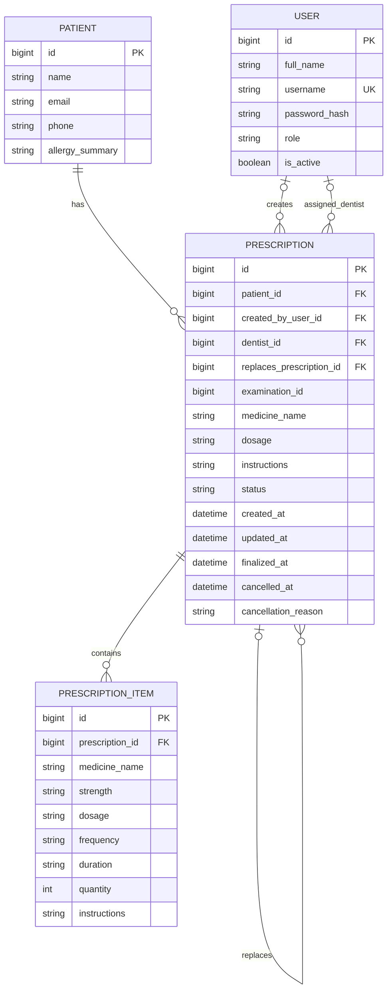

# DentCare Prescription ER Diagram

## Entity Relationship Diagram

## Database Information

Database name: dentcare

Tables:
1. patients
2. users
3. prescriptions
4. prescription_items

## Entity Relationships

1. One patient can have multiple prescriptions.
2. One prescription can contain multiple medicine items.
3. A prescription can reference the user who created it.
4. A prescription can reference its responsible dentist.
5. A replacement prescription can reference an earlier prescription.

## Important Notes

- The Patient relationship is protected by a foreign key.
- Medicine items are linked using prescription_id.
- Creator and dentist references are currently optional.
- User roles will be checked by backend authorization.
- Prescription history must be preserved.
- The examination_id column is retained for future integration.
- Legacy medicine_name and dosage fields remain in prescriptions.
- Password hashes must never be stored as plaintext passwords.

## Implementation Status

- Database tables: Created
- Patient-Prescription relationship: Verified
- PrescriptionItem relationship: Verified
- User relationships: Verified
- Prescription timestamps: Verified
- Complete role-based authorization: Pending
- Finalization and cancellation services: Pending
