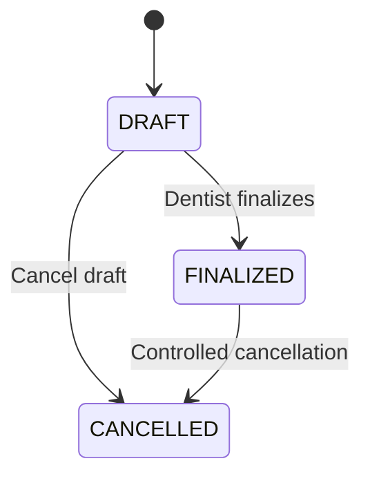

# DentCare Prescription Status Model

## Available Statuses

- DRAFT
- FINALIZED
- CANCELLED

## State Transition Diagram

## Business Rules

1. New prescriptions start as DRAFT.
2. Medicine items can be added while DRAFT.
3. Only an authorized Dentist can finalize.
4. Finalized prescriptions cannot be freely edited.
5. Cancellation must preserve history.
6. Cancellation records a reason and timestamp.
7. Replacement prescriptions reference the original.

## Current Implementation

- Status enum: Implemented
- Default DRAFT status: Implemented
- Basic add-item restriction: Implemented
- History database fields: Implemented
- Five domain tests: Passed

## Remaining Work

- Authorized finalization service
- Controlled cancellation service
- Complete status-transition tests
- Role-based access control
